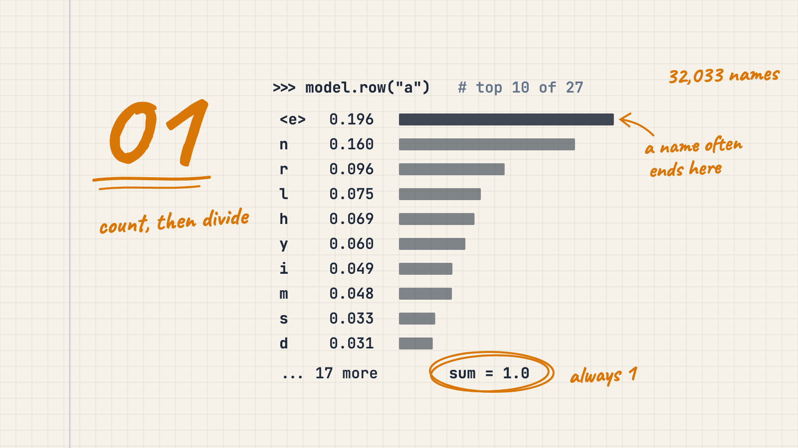
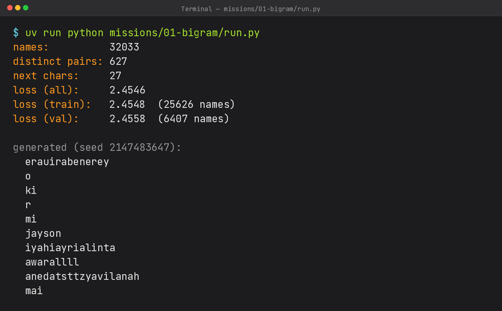

# What an LLM really does, with nothing but counting

*Series "Bilingual LLM from Scratch" · Article 1 · [Leia em português](pt.md) · [Published on Medium](https://medium.com/@luizcampos331/what-an-llm-really-does-with-nothing-but-counting-f6cf7a1e724d)*



```
erauirabenerey, o, ki, r, mi, jayson, iyahiayrialinta, awarallll, anedatsttzyavilanah, mai
```

These ten "names" came out of the first language model I wrote. Most of them are bad. But they are clearly not random noise either: `jayson` and `mai` could be real names, and none of them looks like `xqzvw`. The model behind them has no neural network and no library. It is a Python dictionary that counts which letter follows which.

That is the whole point of this first mission. An LLM (large language model) like GPT does exactly one thing: given what came before, it assigns a probability to every possible next token (a chunk of text). The only difference between GPT and this program is *how* that probability is computed. So before any machinery, I wanted to see the task itself.

## The problem

I've worked in tech for ten years, but my day-to-day never called for probability or logarithms, so it had been a long time since I'd dealt with them. Before writing a single test I spent a few days on six small ideas: probability as counting, conditional probability, sampling, logarithms, loss, and smoothing. Each one shows up below with the example I used in every test: the name `barbara`.

The data is the `names.txt` file from Andrej Karpathy's makemore project: 32,033 real English names, one per line. My plan mentioned tiny-shakespeare, but I switched to the dataset (the collection of examples) from Karpathy's video so I could check my numbers against his.

My study reference was Karpathy's lecture [The spelled-out intro to language modeling: building makemore](https://www.youtube.com/watch?v=PaCmpygFfXo). I didn't copy the code from the video, though. I wrote my own, with TDD (test-driven development: write the test before the code) and with my own structure.

## Probability is just counting

Every name gets a start marker and an end marker. In my code, they are `<s>` (start) and `<e>` (end). So `barbara` becomes `<s> b a r b a r a <e>`. Looking at consecutive characters two at a time, that gives 8 pairs:

```
<s>b  ba  ar  rb  ba  ar  ra  a<e>
```

Each of those pairs is a **bigram** (bi = two): a current character and the next one. The whole model is just counting bigrams.

Now look only at what comes after `a`. It happens 3 times: `r` twice, and `<e>` once. So after an `a`, the next character is `r` with probability 2/3 and `<e>` with probability 1/3. That is all probability is here: how often something happened, divided by how often it could have happened.

The list of options with their probabilities is called a **distribution**, and it always sums to 1 (2/3 + 1/3 = 1). Something has to come next.

## Conditional probability: P(next | current)

The vertical bar `|` reads as "given". P(r | a) means "the probability that the next character is `r`, given that the current one is `a`". Same 2/3 as above, just in the standard notation. Every character gets its own row of options. After `b`, in `barbara`, the only thing ever seen is `a` (twice), so P(a | b) = 2/2 = 1.

In code this is a dictionary whose key is the pair and whose value is how many times that pair appeared. For example, the key `("a", "r")`, a tuple (a fixed pair of values), stores how often `r` followed `a`:

```python
for name in names:
    for bigram in self._pairs(name):
        self.bigram_count_pairs[bigram] = self.bigram_count_pairs.get(bigram, 0) + 1
```

In plain words: for each name, split it into bigrams with `_pairs` and add 1 to that pair's count. `.get(bigram, 0)` returns 0 when the pair has never been seen, so the first occurrence starts from zero.

On the full dataset there are 228,146 bigrams counted (the sum of every pair from every name) and 627 distinct ones, out of 729 possible. Those 729 come from the model alphabet: the 26 letters a through z plus one special marker, which makes 27 characters. In the first character of the pair the marker is `<s>`, and in the second it is `<e>`. Each side has 27 options, so there are 27 × 27 = 729 possible pairs. The cover shows the real row after `a`: out of the 33,885 times an `a` appeared, `a` was followed by `<e>` (end of name) 6,640 times, that is P(`<e>` | `a`) = 6,640 ÷ 33,885 ≈ 0.196, about 20%. Next come `n`, with probability 0.160, and `r`, with 0.096. In English names, `a` is very often the last letter.

## Sampling: why the most likely letter doesn't always win

**Sampling** means drawing the next character from the distribution, instead of always taking the most likely one. If you always took the most likely, every name would be identical. Instead it works like a raffle: letters with higher probability get more tickets. In the `barbara` example with the smoothing I show below, after `a` the `r` holds 3 of the 7 tickets. Python's `random.choices` does exactly that: it takes the options (`row.keys()`) and the weights (`row.values()`, the probabilities) and returns one drawn option:

```python
row = self.row(first_char)
return rng.choices(list(row.keys()), weights=list(row.values()))[0]
```

`row(first_char)` returns the distribution of what can follow `first_char`. `rng` is a "random" number generator (actually deterministic if you fix the seed, as I show later).

In one of my tests, 1,000 draws after `a` gave `r` 434 times. Close to 3/7 ≈ 0.429, but the other 566 draws went somewhere else. That variety is what makes `jayson` possible, and also what makes `awarallll` happen.

Generating a name is a loop: start at `<s>`, draw the next character, use it as the new "current", and stop when you draw `<e>`.

## Logarithms: turning products into sums

I trained on `barbara` alone (already with +1 smoothing, explained below). The probability the model assigns to that whole name is the product of the 8 probabilities of its pairs (`<s>b`, `ba`, `ar`, `rb`, `ba`, `ar`, `ra`, `a<e>`): about 0.00058. On the full dataset, with 228,146 pairs, that kind of product gets so small that Python returns `0.0`.

The logarithm avoids that underflow: it turns the product into a sum. Instead of multiplying probabilities, we add `ln(p)` for each pair (`ln` is the natural logarithm). But `ln` of a probability (a number between 0 and 1) is negative. So we use −ln(p), which stays positive: high probability → small number; low probability → large number.

## Loss: the mean of −ln(p)

The **loss** (also called average NLL, negative log-likelihood) is just the mean of −ln(p) over every pair. Lower is better: the model gave high probability to what actually happened.

For `barbara`, the mean over the 8 pairs is ≈ 0.931. That number became a test. Over the 32,033 names, the loss is 2.4546, close to Karpathy's 2.45. A model that guesses 1/27 for everything scores ln(27) ≈ 3.30. Being at 2.45 beats a uniform guess, but it is still far from great. That is why the names come out bad, without being random.

## Smoothing: the +1 that saves the loss

Here is the trap. If a pair never appeared in training, its probability is 0, and −ln(0) is infinite. A single unseen pair turns the average into infinity.

This is not theoretical. When I split the names into 80% for training and 20% for validation, 9 of the 45,521 bigrams in the validation set never appear in the training set. `siegfried` brings a `g` followed by `f`, and `kvon` a `k` followed by `v`.

The fix is to add 1 to every count, so-called **smoothing**. The idea is to pretend every possible next character has already been seen at least once, so that no probability falls to zero. After `a` in `barbara`, the 4 possible next characters (`b`, `a`, `r`, `<e>`) become: `r` = (2+1)/(3+4) = 3/7, `<e>` = (1+1)/(3+4) = 2/7, and `a` and `b`, never seen after `a`, get (0+1)/(3+4) = 1/7 each. The denominator 3+4 is the real count of times `a` appeared (3) plus 1 for each of the 4 possible next characters. The row still sums to 1, and nothing is zero anymore. On the full dataset, the cost is tiny: the loss goes from 2.4540 without smoothing to 2.4546 with it.

## Train vs. validation

Measuring the loss on the same names used for counting is like grading a student with the exact questions they memorized. So I shuffled the names with a **seed** (a number that fixes the shuffle so it is reproducible; I used 42), counted bigrams only on the 80% training split (25,626 names), and measured the loss on both parts:

```
loss (train):   2.4548  (25626 names)
loss (val):     2.4558  (6407 names)
```

**Training** is the slice the model counts on. **Validation** is a slice it never saw, used only for measuring. Validation is slightly higher, as expected. But the gap is only 0.001. The model isn't **overfitting** (memorizing the training set instead of learning the pattern). It is simply too simple to memorize anything.

## Testing something random

Everything was built with TDD, and the model ended with 15 green (passing) tests. The interesting ones deal with randomness. You can't assert "the next letter is `r`". What you can do:

- **Fix the seed** (the number that fixes the sequence of draws). `random.Random(2147483647)` always produces the same sequence, so the same seed must give the same name. The number itself is arbitrary; what matters is reusing the same one.
- **Test properties, not values.** After `a`, the fraction of `r` over 1,000 draws must be 3/7 ± 0.05 (a tolerance band: I accept anything between about 0.379 and 0.479). A model trained on `barbara` can only generate `b`, `a` and `r`, and never returns a `<s>` or `<e>` marker inside a name.

One surprise: the seed alone wasn't enough. My possible next characters live in a Python `set` (an unordered collection), and the iteration order of a set of strings can change between runs. Same seed, different order of options, different draw. Iterating with `sorted()` (fixed alphabetical order) made it reproducible.

## The OOP bridge

Think of an **interface** (a contract of methods that any implementation must provide) called `LanguageModel`, with two methods: give me the distribution of the next token for a context, and sample from it. My `Bigram` class is the simplest possible implementation: `row(char)` returns the distribution after `char`, and `sample_next(char, rng)` draws the next character from that distribution. The GPT in mission 6 will be another implementation of the same contract. Generation and loss don't care how the distribution was computed.

## Where I got it wrong

My first `generate` passed its test and was wrong. Inside the loop I wrote:

```python
char = self.sample_next(START, rng)
```

In the code, `START` is the `<s>` marker. I always drew from `<s>`, so every letter was chosen as if it were the first letter of a new name. The model never looked at the previous character. The fix was one variable: draw from `previous_char` and update it each turn.

The test didn't catch it because it checked a property, "no markers inside the name", and the buggy version satisfies it. So do the other two generation tests. On the real dataset, the bug is obvious: after `<s>`, `<e>` has a probability of 1 in 32,060 (because the raw count of `<s>`→`<e>` is 0, and with +1 smoothing that becomes 1 ÷ (32,033 + 27) = 1/32,060), so a "name" almost never ends. Rerunning the buggy version with the same seed, the first five names had 13,945, 25,985, 12,783, 3,963 and 8,956 characters. Property tests protect against whole classes of mistakes, but they don't prove the logic is right.

## What comes next

Look at `awarallll` again. After an `l`, the model gives `l` probability ≈ 0.096 every time, because it has no idea it just wrote three of them. One character of context isn't enough.

The obvious fix is a bigger table. Looking at 2 characters back gives 27 × 27 contexts times 27 next options: 19,683 cells. With 10 characters of context it is 27¹¹ ≈ 5.6 × 10¹⁵ cells (about 5.6 quadrillion), while the whole dataset has 228,146 bigrams. Almost every cell would be empty. Counting doesn't scale. We need a model that *learns* numbers instead of counting them, and that starts with the machinery behind every neural network: the next article builds an automatic differentiation engine from scratch (the rule that says which way to nudge each number in the model).

To run everything yourself, from the repository root:

```
uv run python missions/01-bigram/run.py
```

`uv` is the tool this project uses to run Python with the right dependencies. It takes about 9 seconds on my M3 (the Mac chip) and prints every number in this article:



Reading the output, in print order:

- `names` (32,033): how many names the file has.
- `distinct pairs` (627): how many different bigrams the model actually saw, out of the 729 possible.
- `next chars` (27): how many options the model considers for the next character (the alphabet we already covered).
- `loss (all)` (2.4546): the mean of −ln(p) over every pair of every name. Lower is better.
- `loss (train)` (2.4548) and `loss (val)` (2.4558): the same metric on the 80/20 split. The two values are almost equal: the model did not memorize the training set.
- `generated` (seed 2147483647): the 10 names from the top of the article. Most of them are bad; one character of context is not enough.

---

*Code: [github.com/luizcampos331/bilingual-llm-from-scratch](https://github.com/luizcampos331/bilingual-llm-from-scratch) · [Versão em português](pt.md) · Reference: [The spelled-out intro to language modeling: building makemore](https://www.youtube.com/watch?v=PaCmpygFfXo) and [makemore](https://github.com/karpathy/makemore), by Andrej Karpathy · Text licensed under CC BY 4.0*
