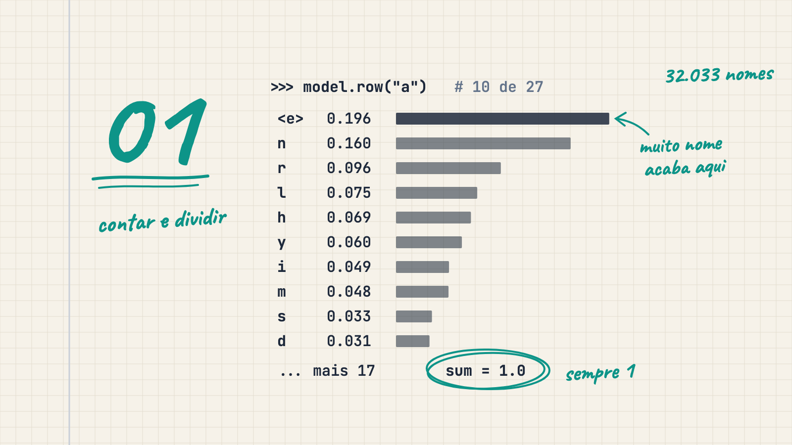
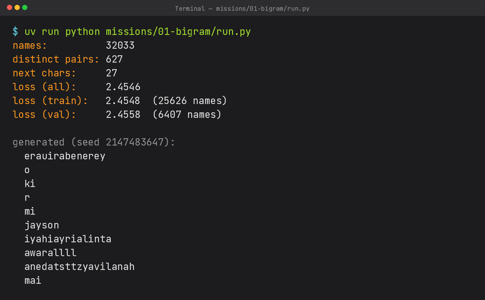

# O que um LLM faz de verdade, só contando letras

*Série "LLM Bilíngue do Zero" · Artigo 1 · [Read in English](en.md) · [Publicado no Medium](https://medium.com/@luizcampos331/o-que-um-llm-faz-de-verdade-s%C3%B3-contando-letras-7862ac08038b)*



```
erauirabenerey, o, ki, r, mi, jayson, iyahiayrialinta, awarallll, anedatsttzyavilanah, mai
```

Esses dez "nomes" saíram do primeiro modelo de linguagem que eu escrevi. A maioria é ruim. Mas também não é ruído aleatório: `jayson` e `mai` poderiam ser nomes de verdade, e nenhum deles parece `xqzvw`. Por trás deles não tem rede neural nem biblioteca nenhuma. É um dicionário Python que conta qual letra vem depois de qual.

Esse é o ponto desta primeira missão. Um LLM (large language model, ou grande modelo de linguagem) como o GPT faz uma coisa só: dado o que veio antes, ele dá uma probabilidade para cada token (pedaço de texto) que pode vir em seguida. A diferença entre o GPT e este programa está em *como* essa probabilidade é calculada. Então, antes de qualquer maquinário, eu quis enxergar a tarefa em si.

## O problema

Trabalho com tecnologia há dez anos, mas meu dia a dia nunca exigiu probabilidade nem logaritmo, então fazia tempo que eu não lidava com isso. Antes de escrever o primeiro teste, passei alguns dias estudando seis ideias pequenas: probabilidade como contagem, probabilidade condicional, amostragem, logaritmo, loss e suavização. Cada uma aparece abaixo com o exemplo que usei em todos os testes: o nome `barbara`.

Os dados são o `names.txt` do projeto makemore, do Andrej Karpathy: 32.033 nomes reais em inglês, um por linha. O meu plano falava em tiny-shakespeare, mas troquei pelo dataset (conjunto de dados) do vídeo do Karpathy para poder comparar os meus números com os dele.

A minha referência de estudo foi a aula [The spelled-out intro to language modeling: building makemore](https://www.youtube.com/watch?v=PaCmpygFfXo), do Karpathy. Mas não copiei o código do vídeo: escrevi o meu, com TDD (test-driven development: escrever o teste antes do código) e com a minha própria estrutura.

## Probabilidade é só contagem

Cada nome ganha um marcador de início e um de fim. No meu código, eles são `<s>` (start) e `<e>` (end). Então `barbara` vira `<s> b a r b a r a <e>`. Olhando de dois em dois caracteres consecutivos, isso dá 8 pares:

```
<s>b  ba  ar  rb  ba  ar  ra  a<e>
```

Cada um desses pares é um **bigrama** (bi = dois): um caractere atual e o próximo. O modelo inteiro se resume a contar bigramas.

Agora olha só o que vem depois do `a`. Isso acontece 3 vezes: duas vezes `r` e uma vez `<e>`. Então, depois de um `a`, o próximo caractere é `r` com probabilidade 2/3 e `<e>` com probabilidade 1/3. Probabilidade aqui é só isso: quantas vezes algo aconteceu, dividido por quantas vezes poderia ter acontecido.

A lista de opções com as suas probabilidades se chama **distribuição**, e ela sempre soma 1 (2/3 + 1/3 = 1). Alguma coisa tem que vir depois.

## Probabilidade condicional: P(próximo | atual)

A barra vertical `|` se lê "dado que". P(r | a) quer dizer "a probabilidade de o próximo caractere ser `r`, dado que o atual é `a`". É a mesma conta 2/3 de cima, só escrita na notação padrão. Cada caractere tem a sua própria linha de opções. Depois do `b`, em `barbara`, só aparece `a` (duas vezes), então P(a | b) = 2/2 = 1.

No código, isso é um dicionário cuja chave é o par e cujo valor é quantas vezes aquele par apareceu. Por exemplo, a chave `("a", "r")`, uma tupla (um par fixo de valores), guarda as vezes em que `r` veio depois de `a`:

```python
for name in names:
    for bigram in self._pairs(name):
        self.bigram_count_pairs[bigram] = self.bigram_count_pairs.get(bigram, 0) + 1
```

Em português: para cada nome, quebre em bigramas com `_pairs` e some 1 na contagem daquele par. O `.get(bigram, 0)` devolve 0 quando o par ainda não existia, para a primeira ocorrência começar do zero.

No dataset inteiro são 228.146 bigramas contados (a soma de todos os pares de todos os nomes) e 627 pares distintos, de 729 possíveis. Esses 729 vêm do alfabeto do modelo: as 26 letras de a a z mais um marcador especial, o que dá 27 caracteres. No primeiro caractere do par, o marcador é `<s>`, e no segundo, é `<e>`. Cada lado tem 27 opções, então são 27 × 27 = 729 pares possíveis. A capa mostra a linha real depois do `a`: das 33.885 vezes em que um `a` apareceu, o `a` foi seguido por `<e>` (fim do nome) 6.640 vezes, ou seja, P(`<e>` | `a`) = 6.640 ÷ 33.885 ≈ 0,196, cerca de 20%. Depois vêm o `n`, com probabilidade 0,160, e o `r`, com 0,096. Em nomes em inglês, o `a` é muitas vezes a última letra.

## Amostragem: por que a letra mais provável nem sempre ganha

**Amostragem** é sortear o próximo caractere a partir da distribuição, em vez de sempre pegar o mais provável. Se você sempre pegasse o mais provável, todo nome sairia igual. Em vez disso, funciona como uma rifa: letras com probabilidade maior ganham mais bilhetes. No exemplo de `barbara` com a suavização que mostro mais abaixo, depois do `a` o `r` fica com 3 dos 7 bilhetes. O `random.choices` do Python faz exatamente isso: recebe as opções (`row.keys()`) e os pesos (`row.values()`, as probabilidades) e devolve uma opção sorteada:

```python
row = self.row(first_char)
return rng.choices(list(row.keys()), weights=list(row.values()))[0]
```

`row(first_char)` devolve a distribuição do que pode vir depois de `first_char`. O `rng` é um gerador de números "aleatórios" (na verdade determinísticos se você fixar a semente, como mostro depois).

Num dos meus testes, 1.000 sorteios depois do `a` deram `r` 434 vezes. Perto de 3/7 ≈ 0,429, mas os outros 566 foram para outras letras. É essa variedade que torna o `jayson` possível, e é ela também que produz o `awarallll`.

Gerar um nome é um loop: começa no `<s>`, sorteia o próximo caractere, usa ele como o novo "atual" e para quando sair o `<e>`.

## Logaritmo: produto vira soma

Treinei só com `barbara` (já com a suavização +1, explicada mais abaixo). A probabilidade que o modelo dá para esse nome inteiro é o produto das 8 probs dos seus pares (`<s>b`, `ba`, `ar`, `rb`, `ba`, `ar`, `ra`, `a<e>`): cerca de 0,00058. No dataset inteiro, com 228.146 pares, esse tipo de produto fica tão pequeno que o Python devolve `0.0`.

O logaritmo evita esse estouro para baixo: transforma o produto numa soma. Em vez de multiplicar as probabilidades, somamos `ln(p)` de cada par (`ln` é o logaritmo natural). Só que `ln` de uma probabilidade (número entre 0 e 1) é negativo. Por isso usamos −ln(p), que fica positivo: probabilidade alta → número pequeno; probabilidade baixa → número grande.

## Loss: a média de −ln(p)

A **loss** (também chamada de NLL média, negative log-likelihood) é só a média de −ln(p) em todos os pares. Quanto menor, melhor: o modelo atribuiu probabilidade alta ao que de fato aconteceu.

Em `barbara`, a média dos 8 pares é ≈ 0,931. Esse número virou teste. Nos 32.033 nomes, a loss é 2,4546, perto dos 2,45 do Karpathy. Um modelo que chuta 1/27 para tudo fica em ln(27) ≈ 3,30. Estar em 2,45 é melhor que o chute uniforme, mas ainda longe do ótimo. Por isso os nomes saem ruins, sem serem aleatórios.

## Suavização: o +1 que salva a loss

Aqui mora a armadilha. Se um par nunca apareceu no treino, a probabilidade dele é 0, e −ln(0) é infinito. Basta um par inédito para a média virar infinito.

Isso não é teoria. Quando separei os nomes em 80% para treino e 20% para validação, 9 dos 45.521 bigramas da validação não aparecem nenhuma vez no treino. O `siegfried` traz um `g` seguido de `f`, e o `kvon`, um `k` seguido de `v`.

A solução é somar 1 em todas as contagens, o chamado **smoothing** (suavização). A ideia é fingir que cada próximo caractere possível já foi visto pelo menos uma vez, para que nenhuma probabilidade caia a zero. Depois do `a` em `barbara`, os 4 próximos possíveis (`b`, `a`, `r`, `<e>`) ficam assim: `r` = (2+1)/(3+4) = 3/7, `<e>` = (1+1)/(3+4) = 2/7, e `a` e `b`, que nunca apareceram depois do `a`, ficam com (0+1)/(3+4) = 1/7 cada. O denominador 3+4 é a contagem real de vezes que `a` apareceu (3) mais 1 para cada um dos 4 próximos possíveis. A linha continua somando 1, e nada mais é zero. No dataset inteiro, o custo é mínimo: a loss vai de 2,4540 sem suavização para 2,4546 com ela.

## Treino e validação

Medir a loss nos mesmos nomes usados para contar é como avaliar um aluno com as mesmas perguntas que ele decorou. Por isso embaralhei os nomes com uma **seed** (semente: um número que fixa a sequência do embaralhamento para ele ser reproduzível; usei 42), contei bigramas só nos 80% de treino (25.626 nomes) e medi a loss nas duas partes:

```
loss (train):   2.4548  (25626 names)
loss (val):     2.4558  (6407 names)
```

**Treino** é o pedaço em que o modelo conta. **Validação** é um pedaço que ele não viu, usado só para medir. A validação ficou um pouco mais alta, como esperado. Mas a diferença é de só 0,001. O modelo não está sofrendo **overfitting** (decorar o treino em vez de aprender o padrão). Ele é simples demais para decorar qualquer coisa.

## Como testar algo aleatório

Tudo foi feito com TDD, e o modelo terminou com 15 testes verdes (passando). Os mais interessantes lidam com aleatoriedade. Não dá para afirmar "a próxima letra é `r`". O que dá para fazer:

- **Fixar a seed** (a semente que define a sequência de sorteios). `random.Random(2147483647)` sempre produz a mesma sequência, então a mesma seed tem que gerar o mesmo nome. O número em si é arbitrário; o que importa é repetir o mesmo.
- **Testar propriedades, e não valores.** Depois do `a`, a fração de `r` em 1.000 sorteios tem que ser 3/7 ± 0,05 (uma margem de tolerância: aceito entre cerca de 0,379 e 0,479). Um modelo treinado com `barbara` só pode gerar `b`, `a` e `r`, e nunca devolve um marcador `<s>` ou `<e>` dentro do nome.

Uma surpresa: só a seed não bastou. Os próximos caracteres possíveis ficam num `set` do Python (um conjunto sem ordem garantida), e a ordem em que um set de strings é percorrido pode mudar de uma execução para outra. Mesma seed, ordem diferente das opções, sorteio diferente. Percorrer com `sorted()` (ordem alfabética fixa) deixou tudo reproduzível.

## A ponte com OOP

Pense numa **interface** (um contrato de métodos que qualquer implementação precisa cumprir) chamada `LanguageModel`, com dois métodos: me dê a distribuição do próximo token para um contexto, e sorteie a partir dela. A minha classe `Bigram` é a implementação mais simples possível: `row(char)` devolve a distribuição depois de `char`, e `sample_next(char, rng)` sorteia o próximo usando essa distribuição. O GPT da missão 6 vai ser outra implementação do mesmo contrato. A geração e a loss não se importam com o jeito que a distribuição foi calculada.

## Onde eu errei

O meu primeiro `generate` passou no teste e estava errado. Dentro do loop eu escrevi:

```python
char = self.sample_next(START, rng)
```

`START` no código, é o marcador `<s>`. Eu sorteava sempre a partir do `<s>`, então cada letra era escolhida como se fosse a primeira de um nome novo. O modelo nunca olhava para o caractere anterior. A correção foi uma variável: sortear a partir do `previous_char` e atualizá-lo a cada volta.

O teste não pegou porque conferia uma propriedade, "nenhum marcador dentro do nome", e a versão com bug cumpre isso. Os outros dois testes de geração também passam com ela. No dataset real, o bug fica escancarado: depois do `<s>`, o `<e>` tem probabilidade de 1 em 32.060 (porque a contagem bruta de `<s>`→`<e>` é 0, e com suavização +1 isso vira 1 ÷ (32.033 + 27) = 1/32.060), então um "nome" quase nunca termina. Rodando a versão com bug com a mesma seed, os cinco primeiros nomes tinham 13.945, 25.985, 12.783, 3.963 e 8.956 caracteres. Teste de propriedade protege contra uma classe inteira de erros, mas não prova que a lógica está certa.

## O que vem a seguir

Olha o `awarallll` de novo. Depois de um `l`, o modelo dá ao `l` a probabilidade ≈ 0,096 toda vez, porque não faz ideia de que acabou de escrever três. Um caractere de contexto não basta.

A solução óbvia é uma tabela maior. Olhando 2 caracteres para trás, são 27 × 27 contextos vezes 27 opções de próximo: 19.683 células. Com 10 caracteres de contexto, são 27¹¹ ≈ 5,6 × 10¹⁵ células (cerca de 5,6 quatrilhões), enquanto o dataset inteiro tem 228.146 bigramas. Quase todas as células ficariam vazias. Contar não escala. Precisamos de um modelo que *aprenda* os números em vez de contá-los, e isso começa pelo maquinário por trás de toda rede neural: o próximo artigo constrói do zero um motor de gradientes (a regra que diz para onde ajustar cada número do modelo).

Para rodar tudo você mesmo, a partir da raiz do repositório:

```
uv run python missions/01-bigram/run.py
```

`uv` é a ferramenta que este projeto usa para rodar o Python com as dependências certas. Leva uns 9 segundos no meu M3 (o chip do Mac) e imprime todos os números deste artigo:



Lendo a saída, na ordem do print:

- `names` (32.033): quantos nomes tem o arquivo.
- `distinct pairs` (627): quantos bigramas diferentes o modelo de fato viu, dos 729 possíveis.
- `next chars` (27): quantas opções o modelo considera para o próximo caractere (o alfabeto que já vimos).
- `loss (all)` (2,4546): a média de −ln(p) sobre todos os pares de todos os nomes. Quanto menor, melhor.
- `loss (train)` (2,4548) e `loss (val)` (2,4558): a mesma métrica no split 80/20. Os dois valores são quase iguais: o modelo não decorou o treino.
- `generated` (seed 2147483647): os 10 nomes do começo do artigo. A maioria é ruim; um caractere de contexto não basta.

---

*Código: [github.com/luizcampos331/bilingual-llm-from-scratch](https://github.com/luizcampos331/bilingual-llm-from-scratch) · [English version](en.md) · Referência: [The spelled-out intro to language modeling: building makemore](https://www.youtube.com/watch?v=PaCmpygFfXo) e [makemore](https://github.com/karpathy/makemore), de Andrej Karpathy · Texto sob CC BY 4.0*
